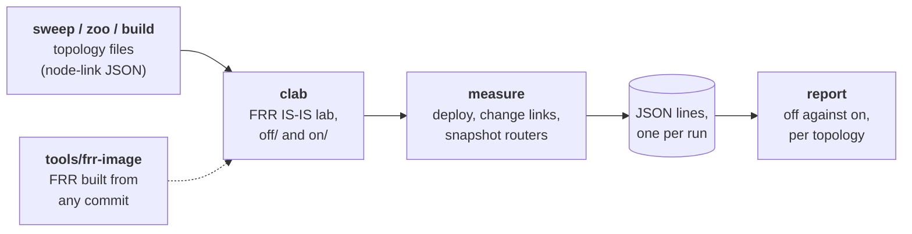
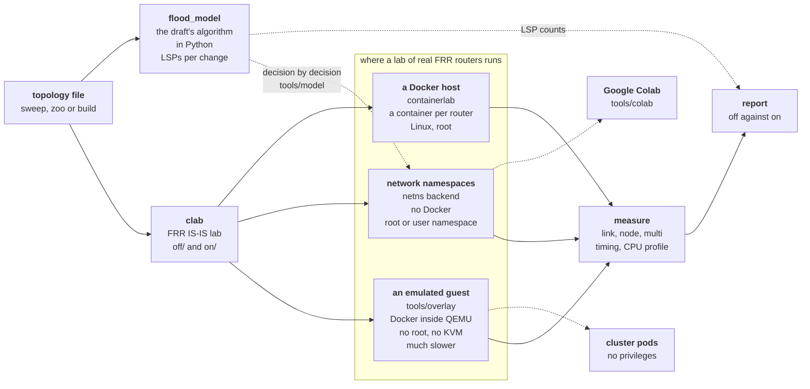
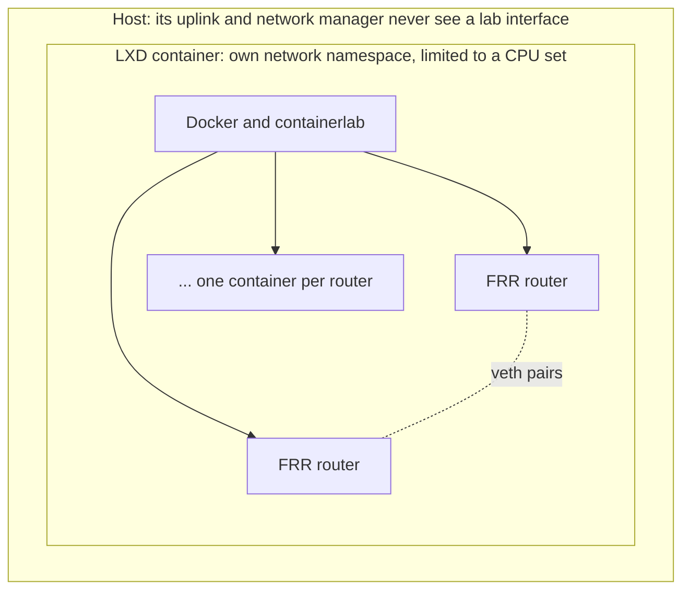
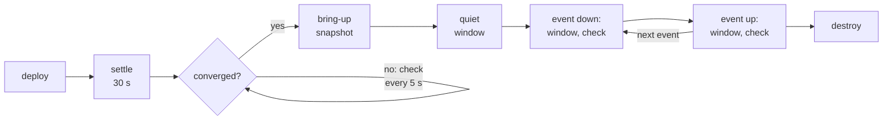

# Topology builders

[](https://github.com/ahb-sjsu/topology-builders/actions/workflows/ci.yml)
[](https://pypi.org/project/topology-builders/)
[](https://pypi.org/project/topology-builders/)
[](https://github.com/astral-sh/ruff)
[](LICENSE)
[](LICENSE-TEXT)

This repository is first an evaluation of IS-IS distributed flooding reduction, draft-ietf-lsr-distoptflood as FRR
implements it in pull request 24128, and second a topology library. The measurements, their data and the scripts
that reproduce their tables are in [`results/`](results/): what flood reduction saves in LSPs (link-state PDUs, the
messages each router floods to describe its links) and in the CPU of isisd (FRR's IS-IS daemon) on
random graphs, flattened and multistage butterflies, leaf-spine fabrics and fat-trees, how that depends on density
and structure, and why flooding can be seconds slower with it after a router or several links fail.

The library is what the evaluation is built from: generators for network topologies whose density can be stepped
while the number of routers stays fixed (four of the six families), so that an experiment can tell the effect of
density from the effect of size; an exporter to FRR IS-IS labs; a harness that measures them with the change off and
on; and a model of the draft's algorithm. They were written for this evaluation and are tested most there; they may
serve other link-state experiments.



## Ways to run a test

A topology can be tested two ways: by the model of the draft's algorithm, which needs only Python, or as a lab of
real FRR routers, which can run in three places.



| Option | What runs | Needs | Speed | Status, 2026-11-21 |
|---|---|---|---|---|
| Model: `flood_model` | the draft's reflood decision, no FRR | Python | milliseconds per change, any size | with flood reduction on, within 20% of FRR's LSP counts on link-down windows on 26 of 28 64-router topologies, and within 15% on all 14 graphs of the seeds-n64 and random-regular-n128 runs, where its lockstep saving is within 5 points of FRR's; on fat-trees and n-flies (20 to 180 switches) within 5% when a link goes down, with FRR saving 7 to 14 points more than the lockstep figure |
| Docker labs: `measure` | real FRR, a container per router | Linux, root, Docker, containerlab | real time | the measurements on Atlas (an HP Z840 workstation with two Xeon E5-2690 v3) in `results/`, except mechanism, model-decisions and colab-shaped, up to 180 routers; 256-router Docker labs could not be deployed on Atlas |
| Namespace labs: `measure --backend netns` | real FRR, a network namespace per router | Linux, root or `unshare -Urnm` | real time | the Colab results, and on Atlas the decision check, the failure replay (mechanism) and colab-shaped. With the same links as a Docker run on Atlas, Colab's LSP counts with flood reduction on nearly matched it, and without it were 5% to 15% lower. On Atlas, 256-router labs run (degree 4 and 8 converged in every run, at about 35 and 48 MiB per router; degree 16 never converged on 20 CPUs, with or without flood reduction), and larger ones are running |
| Colab: `tools/colab` | namespace labs on a Colab runtime | a Google account | real time, on the runtime's CPUs | passed `test_in_docker.sh` (Colab's permissions, 2 CPUs); on Colab itself, 16-router labs converged on free CPU and TPU runtimes, and 64-router labs of up to 768 links in four Pro sessions with 8 CPUs, whose LSP savings agreed within 1 point (2026-11-21) |
| Emulated guest: `tools/overlay` | Docker labs inside QEMU, software emulation | QEMU; no root, no KVM | much slower: deploying a 16-router lab took 225 s, against 9 s on the host | a 16-router lab runs on the host and in a cluster pod; link-down LSP counts within 17% of the host's; link-up, router and multi-link windows 1.2 to 1.7 times, bring-up 1.5 to 2.6 times; scaling timers by 10 is not a fix; CPU and times not comparable |
| Decision check: `tools/model` | FRR's logged decisions against the model's | as namespace labs | real time | all 1,186 decisions logged on five topologies match the model, given the snapshot each router used; after router and multi-link failures, it shows which relays decided with the topology from before the failure |

Kaggle's notebooks refuse user namespaces, so of the lab options only the emulated guest could run there (untested).
Details: [the model](#a-model-of-flooding), [namespaces and Colab](#without-docker-and-on-colab),
[the emulated guest](tools/overlay/README.md), [measure](#measuring-flooding-and-cpu),
[the decision check](tools/model/README.md).

## Families

| Family | What it is | Density knob at N routers |
|---|---|---|
| `random-regular` | Every router has exactly d links, chosen at random. networkx `random_regular_graph`; above d = (N - 1)/2, the complement of a random (N - 1 - d)-regular graph. A disconnected draw is drawn again. | d = 3, 4, 6, 8, 12, ... up to N - 1 (with N odd, even d only) |
| `leaf-spine` | Two-tier Clos: every leaf is linked to every spine | 2, 3, 4, 6, 8, ... spines up to N/2, the rest leaves |
| `flattened-butterfly` | Routers on a grid of radices k1 x k2 x ...; each is linked to every router that differs from it in one coordinate (Kim, Dally and Abts, ISCA 2007). One radix N is the full mesh; all radices 2 is the hypercube. | every factorization of N (a prime N has only the full mesh) |
| `zoo` | A Topology Zoo graph, in TopoHub's packaging, made denser by adding links: at random, or shortest great-circle distance first | target average degree, up to N - 1 |
| `k-ary-n-fly` | The butterfly: n stages of k^(n-1) switches, each linked to the k switches of the next stage whose position differs from its own in one base-k digit. Switches only, no hosts. | none: the size grows with k and n, so it is not in the sweep |
| `fat-tree` | The k-ary fat-tree, a three-tier Clos (Al-Fares, Loukissas and Vahdat, SIGCOMM 2008): k pods of k/2 edge and k/2 aggregation switches, fully linked within the pod, and (k/2)^2 core switches, each linked to one aggregation switch in every pod. 5k^2/4 switches, k^3/2 links. Switches only, no hosts. | none: the size grows with the radix k (k = 8: 80 switches, 256 links), so it is not in the sweep |

Random-regular and flattened-butterfly both end at the full mesh. Leaf-spine is densest at N/2 spines, where the
average degree is N/2.

The two ways of adding links to a Zoo graph give very different networks. On TataNld (143 routers, 181 links), at
an average degree of 8 the diameter is 16 hops with nearest-first and 4 with random links. Added links are nested:
with the same method and seed, every link added for a lower target is also there at a higher one, so a denser graph
differs from a sparser one only by the extra links.

## Output

Each topology is one JSON file in NetworkX node-link form, with keys `nodes` and `edges`, the shape TopoHub uses.
It can be read with `networkx.node_link_graph(data, edges="edges")`. Routers are named `r0`, `r1`, .... The graph
attributes record:

- the family, its parameters and how it was built;
- routers, links, average degree, density, minimum and maximum degree, and whether it is connected;
- the diameter and mean distance in hops, and the share of router pairs at most two hops apart (left out, as null,
  when routers x links is over 20 million);
- the two-hop multiplicity: for two routers two hops apart, the mean number of neighbors they share, which is how
  many two-hop paths join them (left out when the sum of squared degrees is over 20 million). A flooding rule that
  looks two hops ahead can drop copies only where it is above 1. It is 2 in every flattened butterfly; in a random
  regular graph of degree d it is close to 1 while d²/N is small, then grows roughly as d²/N. That may be why
  butterflies gain far more from flood reduction than random graphs of the same degree;
- the versions of this package, Python and networkx.

The `sweep` and `zoo` commands also write `manifest.json`, with each file's SHA-256 and summary. Nodes, edges and
keys are sorted, so the same versions and parameters give byte-identical files.

## Use

```
pip install topology-builders
```

The command is `topology-builders`; `python -m topology_builders` does the same.

```
python -m topology_builders sweep --routers 64 --seeds 1,2,3 --out out/n64
python -m topology_builders zoo <topohub>/data/topozoo/TataNld.json --method nearest --degrees 4,8,16 --out out/tata
python -m topology_builders build flattened-butterfly --radices 8,8 --out ff-8x8.json
python -m topology_builders build k-ary-n-fly --k 4 --stages 3 --out fly-4x3.json
python -m topology_builders build fat-tree --k 8 --out fat-tree-k8.json
```

Without `--degrees`, `zoo` steps from just above the graph's own average degree to the full mesh. The Zoo data is
not included, because TopoHub's packaging states no license: point `zoo` at a local copy.

## FRR IS-IS labs

`clab` turns one topology file into a [containerlab](https://containerlab.dev) lab of FRR routers running IS-IS:

```
python -m topology_builders clab out/n64/random-regular-n64-d8-s1.json --out labs/rr64-d8
containerlab deploy -t labs/rr64-d8/off/random-regular-n64-d8-s1-off.clab.yml
```

By default it writes two labs, in `off/` and `on/`, which differ only in one line: `flood-reduction` under
`router isis`, the switch added by FRR pull request 24128 (draft-ietf-lsr-distoptflood). The `on` lab needs an FRR
image built with that change; FRR releases reject the command. The configuration follows that pull request's
topotest:

- level-2-only, with a passive loopback /32 on each router (10.255.0.0/16);
- each link point-to-point, with its own /31 (10.0.0.0/9);
- hello interval 1 s, hello multiplier 3, lsp-gen-interval 2 (each can be changed on the command line).

`--cpu-set 12-23,36-43` confines every router of the lab to those CPUs (containerlab's `cpu-set`), so that a dense
lab cannot take the whole host and its runs see the same CPUs every time.

Run large labs inside a container or VM with its own network namespace, not directly on a host whose own network
matters. A 64-router lab creates over a thousand interfaces in the namespace containerlab runs in. On one host,
deploying a 512-link lab made systemd-networkd time out and give up on the host's uplink, whose DHCP lease then
lapsed. We now run containerlab and its own Docker inside a privileged LXD container with nesting enabled:



In a test with an 8-router lab, the host's interface count did not change during deployment and systemd-networkd
logged nothing about the lab.

Each lab directory holds the containerlab file, one directory per router, `lab.json` (every router's loopback,
NET and port count, and every link's ports and addresses) and `manifest.json` (SHA-256 of each file). Node kind
`linux` (the default) mounts `frr.conf`, `daemons` and `vtysh.conf` into any FRR image and works with every
containerlab version. `--kind frr` uses containerlab's own FRR kind, which needs containerlab 0.80.0 or later. TopoHub
files can be given directly; their nodes are renamed r0, r1, ... in order, and `lab.json` keeps the original ids.

`python3 tools/check_isis.py <lab directory> [timeout]`, in this repository (pip does not install it), checks a
deployed lab through `docker exec`: every router
must have one adjacency Up per link and an LSP from every router. It retries every 5 s until the timeout (default
120 s) and exits non-zero if the lab never gets there.

Tests: `python -m pytest`. CI runs them, and ruff, on Python 3.10 to 3.13 on every push to main and every pull
request. They check each family
against its definition: degrees and connectivity; that the
flattened butterfly equals networkx's Cartesian product of complete graphs and the hypercube; that the butterfly has
exactly one forward path between each first-stage and each last-stage switch; and that zoo additions keep the
original links, nest, and with nearest-first add the shortest links. For the labs they check that ports run eth1 to
ethN on every router, that both ends of each link share a /31, that the containerlab file matches the link list, and
that the `on` and `off` configurations differ only in the `flood-reduction` line. For `measure` they check the
parsers against output captured from a live lab (`tests/fixtures`), the outcome rules, the choice of link and the
totals.

Measured on an HP Z840 (Xeon E5-2690 v3; Python 3.12.3, networkx 3.6.1), 2026-11-18:

- all 17 tests pass (48 now, with `measure`, `report` and the model);
- the 64-router sweep with seeds 1, 2 and 3: 50 topologies, all connected, in 1.0 s in all (0.03 s or less each),
  and a second run gives byte-identical files (50 of 50 SHA-256 equal);
- random-regular at 256 routers, d = 3 to 255: 14 topologies in 3.1 s in all (15 s on 2026-11-19, with the distance and two-hop figures added to every file), the largest with 32,640 links;
- two `off` labs deployed with containerlab 0.78.2 and FRR 10.2.1. In each, every router had one IS-IS adjacency Up
  per link and an LSP from every router: the 8-router flattened butterfly 4 x 2 within 8 s of deployment, and a
  32-router random regular graph of degree 6 (96 links) within 5 s. The 32-router lab took 16 s to deploy, and
  each router used about 20 MiB. In the 8-router lab, router r0 had IS-IS routes to all 7 other loopbacks and
  reached a loopback two hops away.

## An FRR image from any commit

The `on` labs need FRR built with the flood-reduction change. `tools/frr-image/build.sh` builds an image from any FRR
commit with FRR's own Alpine packaging (`docker/alpine` in the FRR tree), so it has the layout of the official
images and the labs run on it unchanged:

```
CPUSET=36-47 THERMAL=1 tools/frr-image/build.sh work https://github.com/riw777/frr \
    e263c441160c7cf25749a9695978ffe5649678f9 frr-distoptflood:e263c441
python -m topology_builders clab topology.json --out lab --image frr-distoptflood:e263c441
```

- It uses Docker's classic builder, so buildx is not needed. FRR's Dockerfile needs BuildKit for two lines, so
  `make_dockerfile.py` writes a version without them: it drops the `# syntax=` line and replaces `COPY --exclude`
  with an extra stage that deletes the same packages. Every other line is FRR's.
- `CPUSET` caps the build's CPUs. FRR's packaging runs `make -j $(nproc)`, and `nproc` follows the cap.
- `THERMAL=1` holds the build under [batch-probe](https://github.com/ahb-sjsu/batch-probe)'s ThermalController.
  `thermal_pause.py` pauses the build's containers while the controller recommends fewer than half the build's
  CPUs.
- FRR's packaging runs FRR's unit tests, and the build fails if they do.

Built on the HP Z840 above, 2026-11-19, from FRR pull request 24128 at e263c441 (FRR 10.9.0-dev):

- 12 minutes on 12 CPUs; the CPU temperature peaked at 75.6 C, and the build was never paused;
- FRR's unit tests: 570 passed, 1 skipped, including the pull request's flood-reduction tests;
- image size 131 MB;
- on the 8-router flattened butterfly, the `off` and `on` labs each reached one adjacency Up per link and an LSP
  from every router within 8 s;
- in the `on` lab, `flood-reduction` was in the running configuration, and `show isis summary` listed the
  flooding-reduction counters;
- that image was built with a first version of these scripts. Rebuilt with `build.sh` itself (9 minutes, peak
  75.4 C), it gave the same FRR and libyang packages and the same test result. The image ID differs: the classic
  builder took steps 1 to 17 from its cache and ran the rest again, from `ARG PKGVER` on, for a reason not found.

Without root, or on a cluster whose pods get no added capabilities, run the labs inside a guest kernel under
software emulation: [tools/overlay](tools/overlay/README.md). Docker, containerlab, the FRR image and
topology-builders run inside the guest, and the QEMU process needs no capabilities and no `/dev/kvm`.

## Measuring flooding and CPU

`measure` deploys labs written by `clab` and measures them around events: a link going down and coming back up,
a router failing, or several links failing at once.

```
topology-builders clab rr32.json --out labs/rr32 --image frr-distoptflood:e263c441
topology-builders measure labs/rr32/off labs/rr32/on --repeat 2 --out measurements.jsonl
```

One run of one lab:



1. Deploy it, then wait 30 s (`--settle`) without querying the routers.
2. Check that every router has one adjacency Up per link and the same LSPs as every other router; if not, keep
   checking every 5 s, for up to 120 s (`--max-wait`).
3. Snapshot every router: the PDU counters of `show isis summary` (sent, received and dropped, per PDU type), its
   flooding-reduction counters, and the CPU time of isisd and zebra from /proc. This closes the bring-up phase.
4. A quiet window: snapshot, wait 30 s (`--window`) with no event and no queries, snapshot, then check that no
   router's LSPs changed. It measures the background work (hellos every second on every link, timers) that every
   window contains.
5. For each event in turn (default: one link): snapshot, apply it, wait the same 30 s, snapshot, then check that
   every router holds the same LSPs, including a newer LSP from every router the event touched. Undo it (bring the
   links back up) and do the same.
6. Destroy the lab.

- Every window is the difference between a snapshot taken just before it and one at its end, so the checks between
  windows are never counted. Bring-up counts from the routers' start, so it includes the convergence check.
- The link windows are also reported net of the quiet window, which has the same length: the work the event caused.
- Each link window has an outcome: satisfied when every router holds the same LSPs and the new ones, violated when
  not, and unknown when a router could not be read. The quiet window is satisfied when nothing changed in it.
- The links are chosen from the topology file and `--seed`, so the off and on labs use the same ones; the first is
  the same whatever `--links` is. The labs take turns, and the order alternates between repeats.
- Before each run, the harness waits while the hottest CPU sensor is above `--max-temp` (default 80 C), and records
  how long it waited.
- Each run is one JSON line, with per-router figures and the host's load average and CPU temperature at start and
  end. A table of means per lab and phase is printed at the end.

Events (`--event`, with `--links N` events of each kind per run):

| Kind | What happens | Checked after the down window |
|---|---|---|
| `link` (default) | one link down, then up | every router holds the same LSPs, with a newer LSP from both ends |
| `node` | every link of one router down at once, as when it fails; then all up | the failed router is left out; every other router holds the same LSPs, with a newer LSP from each of its neighbors |
| `multi` | `--fail` links (default 2) down at once, chosen so the graph stays connected; then all up | as for `link`, for every end of every failed link |

Several kinds can share one deployment, run in the order given: `--event link,node,multi`. The routers, links and
sets are chosen from the topology file and `--seed`, so every variant gets the same ones.

Two options record more about each event window:

- `--profile`: isisd's own CPU accounting per event handler (`show event cpu`), cleared at the start of every window.
  It shows where the CPU goes, for example route computation (`isis_run_spf_cb`) against receiving LSPs
  (`isis_receive`), and the handler's call count gives the number of route computations.
- `--timing`, for labs written with `clab --timing-logs`, in which every router logs each LSP it builds or receives
  with microsecond timestamps. For each window it records, per router, when it first held every new LSP; the
  convergence time (from the event to the last router holding them); and the flooding time alone (from each LSP's
  origin to the last router holding it). The routers share one clock, the host's. Debug logging costs CPU, so
  timing runs are kept out of the CPU tables.

`topology-builders report <files>` prints, per topology, its diameter and two-hop multiplicity (for labs written
by 0.2.0 or later), the event windows of one kind (`--event`, default link) pooled and paired, bring-up, and,
when present, convergence times and the CPU per handler. `--pool-seeds` merges
graphs that differ only in their seed into one row, with each saving's range across graphs. `--json` gives the
same rows as JSON. Rows are named by family and parameters; where one name covers graphs of more than one size,
the number of routers is added to it, so `--pool-seeds` and the timing and per-handler tables keep sizes apart.

Runs of 2026-11-19 on the HP Z840 above, with the image from FRR pull request 24128 at e263c441, 2 repeats of each
lab. The host's load average was 4 to 11 from other work. Means, flood reduction off and on; LSPs sent and isisd CPU
are summed over all routers:

| Topology | Window | LSPs sent | isisd CPU net of the quiet window |
|---|---|---|---|
| flattened butterfly 4 x 2: 8 routers, 16 links, degree 4 | link down | 44 and 18 (-59%) | 15 and 20 ms |
| | link up | 73 and 26 (-64%) | 90 and 40 ms |
| random regular: 32 routers, 96 links, degree 6 | link down | 265 and 150.5 (-43%) | 380 and 205 ms (-46%) |
| | link up | 388 and 232.5 (-40%) | 720 and 385 ms (-47%) |

- All 32 windows were satisfied, the quiet ones included: in them no LSP was sent and no router's LSPs changed.
- On 32 routers the repeats do not overlap: net CPU for link down was 310 and 450 ms off, 190 and 220 ms on; for
  link up, 700 and 740 ms off, 370 and 400 ms on.
- On 8 routers the CPU an event causes is within the noise: the quiet windows alone ranged from 490 to 540 ms.
- At bring-up, LSPs sent fell from 375.5 to 303 on 8 routers and from 10,623.5 to 9,091.5 on 32.
- An earlier set of runs, without the quiet window, gave link-window LSP counts within 8% of these. Its CPU figure
  for link up also counted the check that ends the link-down window; each window now starts from its own snapshot.
- Two topologies of different families and sizes, and one link each, say nothing about density; the results below
  do.

**Density.** [results/random-regular-n64](results/random-regular-n64/README.md): 64-router random regular graphs of
degree 3 to 48. LSPs sent for a link change fall by 7% at degree 3 and by 94% at degree 32; isisd CPU for a link
change is a median 14% to 23% lower from degree 8 and not measurably lower below it (a rerun of degree 16 in a
different setup gave 10% instead of 19%); at degree 48, without flood
reduction, the 64 routers did not converge on the host's CPUs, and with it they did.

**Structure.** [results/families-n64](results/families-n64/README.md): flattened butterflies and leaf-spine fabrics
of 64 routers. Butterflies send 60% to 75% fewer LSPs for a link change from degree 6, where random graphs of the
same degree save 23%; on leaf-spine, with flood reduction on, a link change costs about 170 to 190 LSPs at any number
of spines, and isisd CPU per link change is lower in every pair, by a median of 22% to 40%. At 960 and 1,024 links, without flood
reduction the routers never converged on 20 CPUs; with it they did. The two-hop multiplicity lines up with the
saving better than the degree does.

**Ten links at once.** [results/flap10-n64](results/flap10-n64/README.md): ten links down at once and back up, on the
64-router random graphs of degree 16 and 24. Flood reduction sends 78% and 89% fewer LSPs and uses 48% and 59% less
isisd CPU, lower in every pair; the saving is in receiving LSPs, while route computation costs the same.

**Timing.** [results/timing-n64](results/timing-n64/README.md): flooding and convergence times from the routers' own
logs, for single links, router failures and three links failing at once. Single link changes flood in the same tens
of milliseconds either way; when a router fails or several links fail together, flooding with flood reduction on was
often seconds slower (up to 8 s), though every router still ended with the same LSPs.

**Why flooding was slow after failures.** [results/mechanism](results/mechanism/README.md): the same failures again,
with flooding, CSNP and PSNP logs (complete and partial sequence-number PDUs, which routers exchange to repair their
databases). The routers that got a new LSP more than a second late got it through the periodic CSNP exchange (241 of
249), because a neighbor that held it decided with the topology from before the failure and
left them to a router that had just lost its links (shown for 172 of the 249, by the model reproducing the
neighbor's logged decision only with that topology). Without flood reduction, on the same butterfly and failures,
every router had every new LSP within 236 ms.

**Three graphs per degree, and where the CPU goes.** [results/seeds-n64](results/seeds-n64/README.md): three random
graphs at each of degree 4, 8, 16 and 32, with isisd's CPU per event handler. The LSP saving barely depends on the
graph (36%, 35% and 34% at degree 8; 75%, 75% and 74% at 16). Route computation is 82% to 95% of isisd's CPU for a
link change and costs about the same with flood reduction on (13% to 15% less on the butterfly and leaf-spine, whose
routers ran fewer route computations), which is why CPU falls so much less than LSPs. CPU savings
also repeat less well than LSP savings: the 4x4x4 butterfly's median 22% in the families sweep was 5% in this run. At
degree 32, without flood reduction none of the 9 runs converged on 20 CPUs.

**128 routers.** [results/random-regular-n128](results/random-regular-n128/README.md): degree 4, 8 and 16 at 128
routers. LSPs fall by 8%, 19% and 53%, less than at 64 routers of the same degree; matched by two-hop multiplicity
instead of degree, the two sizes agree. isisd CPU falls by 1% to 8%: route computation is nearly all of it, and each costs twice
as much as at 64 routers. 256-router labs could not be deployed with containerlab on this host; with the namespace
backend they run (next).

**256 routers.** [results/random-regular-n256](results/random-regular-n256/README.md): degree 4, 8 and 16 at 256
routers, on the namespace backend. LSPs fall by 9% and 15% at degree 4 and 8, following the two-hop multiplicity
down with size (degree 8: 35%, 19% and 15% at 64, 128 and 256 routers); isisd CPU falls 9% at degree 4 and not at
all at degree 8, where receiving LSPs costs 2.5 times as much with flood reduction on. At degree 16 (2,048 links)
the network never converged on 20 CPUs, with or without flood reduction: it flooded itself continuously (6.5
million LSPs in a 30 s window with no event) while adjacencies kept expiring, and flood reduction, which suppressed
about 6% of the sends, did not rescue it as it did at 64 routers and degree 32. Larger sizes are running
([Not here yet](#not-here-yet)).

**Multistage butterflies.** [results/nfly](results/nfly/README.md): FRR on four k-ary n-flies of 27 to 80 switches.
LSPs for a link change fall by 25% and 32% on the 2-ary flies and by 51% and 57% on the 3- and 4-ary 3-flies,
following the two-hop multiplicity (about 1.25 against 1.62 and 1.82); isisd CPU shows no consistent difference, route
computation being most of it. [results/model-nfly](results/model-nfly/README.md): the model on n-flies up to 2,304
switches, each beside a random graph of the same size and degree, which saves far less (18% against 49% at 48
switches, 1% against 31% at 1,280, lockstep figures).

**Fat-trees.** [results/fat-tree](results/fat-tree/README.md): FRR on k-ary fat-trees from k = 4 (20 switches) to
k = 12 (180 switches, 864 links). LSPs for a link change fall by 40% at k = 4 and 68% at k = 12, and at bring-up by up
to 55%; isisd CPU for a link change is lower in 23 of 30 pairs, by a median of 2% to 29%. Without flood reduction the
180 routers still converged on 20 CPUs. [results/model-fat-tree](results/model-fat-tree/README.md): the model up to
k = 24 (720 switches), where the saving nears two-thirds while random graphs of the same size and degree stay near
20%.

## Without Docker, and on Colab

`measure --backend netns` runs every router in a network namespace of one machine instead of a container: no Docker
or containerlab, links as veth pairs, FRR's daemons started per router with `-N`. It needs root, or a user namespace
in which the process is root:

```
unshare -Urnm topology-builders measure labs/rr16/off labs/rr16/on --backend netns
```

[tools/colab](tools/colab/README.md) uses it to run the labs on Google Colab: `setup.sh` builds FRR from the flood
reduction pull request with only the daemons the labs use, and two notebooks run the labs, one lab at a time or in
several sessions at once ([results/colab-sessions](results/colab-sessions/README.md)). On Atlas the namespace backend
ran the decision check and the failure replay of [results/mechanism](results/mechanism/README.md), and it is running
the labs of 256 routers and more. A Colab CPU runtime allows user namespaces with network devices (checked on
2026-11-20); Kaggle's does not. **Status:** the recipe passed end to end in `test_in_docker.sh`, a container with
Colab's permissions and 2 CPUs: a 16-router random graph and a k = 4 fat-tree, flood reduction off and on, every run
converged and every window consistent, link-change LSP counts within 12% of the Docker labs' on the same graph
([results/colab-shaped](results/colab-shaped/README.md)). On Colab itself, `topology_builders_sessions.ipynb` ran in
several sessions at once on 2026-11-21: 16-router labs converged in every run on the free CPU and TPU runtimes and on
a Pro CPU runtime; [tools/colab](tools/colab/README.md) lists what each runtime type offers.

**Other machines.** [results/colab-sessions](results/colab-sessions/README.md): three Colab Pro sessions (8 CPUs
each, at the same time) ran the 64-router butterfly, the random graph of degree 16 and leaf-spine of the Atlas runs,
with other links; a fourth ran the probe ladder, up to 64 routers and 768 links. Every run converged and every window
was consistent. The LSP saving was the same on every machine within 1 point (60%, 71% to 72%, 92% to 93%). Against
Atlas it was the same on leaf-spine, 3 points lower at degree 16 and 8 to 10 points lower on the butterfly. Running
the Colab links on Atlas split that gap. With flood reduction on, the same links sent nearly the same LSPs in both
setups (within 7%). Without it, Atlas's Docker labs sent 5% to 15% more than Colab's namespace labs. So the
butterfly's gap is 5 to 7 points from the links and 3 from the setup, and degree 16's is all setup. The CPU
saving per link change, pooled over the sessions, was close to Atlas's (11%, 10%, 28%). Single sessions, though, gave
-56% to 15% on the same graph: the quiet window it is net of varied by up to 27% there, against at most 9% on Atlas.

## A model of flooding

`flood_model` counts the LSPs a change floods, with and without flood reduction, as draft-ietf-lsr-distoptflood-14
specifies it (the reflood decision of section 1.2.3, the reverse optimization of section 1.2.2), in milliseconds and
at any size. It is written from the draft's text; its Figure 2 checksums are tests, and the module says where the
draft leaves a choice open and which reading it takes.

```python
from topology_builders import clab, families, flood_model as fm

routers, links = clab.plan(families.random_regular(64, 16, 1))
topo = fm.Topology.from_lab(routers, links)
link = (links[0]["a"], links[0]["b"])
for reduction in (False, True):
    print(reduction, fm.flood_link_change(topo, link, "down", reduction)["sent"])
```

On the link-down windows of the first two 64-router sweeps, with flood reduction on, the model with jittered link
delays is within 20% of the LSPs FRR sent on 26 of 28 topologies (the exceptions: the flattened butterfly 16×2×2,
29% over, and the random graph of degree 48, 27% under; `model.txt` in
[random-regular-n64](results/random-regular-n64/README.md) and [families-n64](results/families-n64/README.md)),
and within 15% on all 14 graphs of 64 and 128 routers measured since; there its lockstep saving
(every link takes one time unit, with no processing delay) is within 5 points of FRR's ([seeds-n64](results/seeds-n64/README.md), [random-regular-n128](results/random-regular-n128/README.md);
`tools/model/validate.py` makes the comparison). On fat-trees and n-flies of 20 to 180 switches it is within 5% of
FRR's count when a link goes down, and exact on 5 of the 9; there FRR saves 7 to 14 points more than the lockstep
figure, because without flood reduction FRR sends more than the lockstep count
([fat-tree](results/fat-tree/README.md), [nfly](results/nfly/README.md)). Without flood reduction the count depends on timing, which decides how many copies a router receives
before it sends; the model brackets it rather than predicts it. It leaves out CPU, timers, retransmissions, recovery
by CSNP and PSNP, and the database exchange over a new adjacency. Checked decision by decision against isisd's own
debug log ([results/model-decisions](results/model-decisions/README.md)), every one of 1,186 decisions matches,
given the topology snapshot the router decided with; after a link came up, most decisions (326 of 514) already used
a snapshot with the new link, while `flood_link_change` assumes the snapshot without it.

## Not here yet

- FRR runs of n-flies above 80 switches and fat-trees above k = 12 (model only so far:
  [model-fat-tree](results/model-fat-tree/README.md), [model-nfly](results/model-nfly/README.md)).
- 512 to 2,048 routers. These are running on Atlas with the namespace backend (from 2026-11-21): random regular
  graphs of degree 4, 8 and 16, one size after another, after the 256-router results above. Before each size's
  labs start, a prediction of its saving from the two-hop multiplicity is written down and hashed, for a sealed test
  of that law in the [observation-theory-campaigns](https://github.com/ahb-sjsu/observation-theory-campaigns)
  repository (`experiments/PREREG-FL1-001.md`). The data and tables go into `results/` when each size finishes.
- An exporter to netlab, as a second, independent path to FRR IS-IS.

[SURVEY.md](https://github.com/ahb-sjsu/topology-builders/blob/main/SURVEY.md) lists the existing builders and lab tools, with licenses and status, so that this repository
can link to and wrap them rather than rewrite them.

## License

Two licenses, split by what the file is.

| What | License | File |
|---|---|---|
| Code (`topology_builders/`, `tests/`, `tools/`, the scripts in `results/`) | MIT | `LICENSE` |
| Text and data (the READMEs, SURVEY.md, the data and tables in `results/`) | CC BY 4.0 | `LICENSE-TEXT` |
