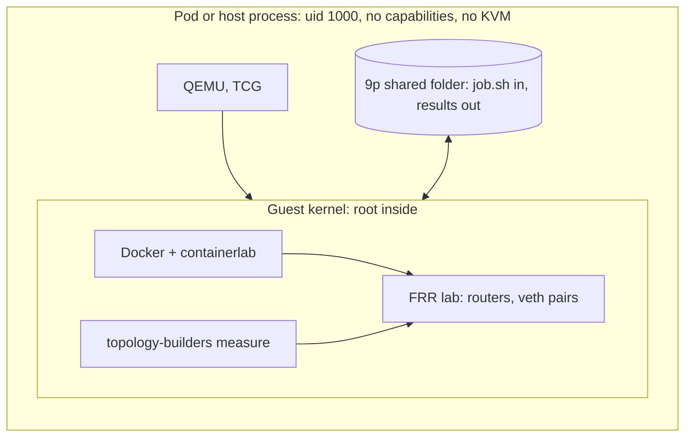

# The overlay: FRR labs without privileges

containerlab needs root, and so does anything that creates network namespaces, veth pairs or routes. On a cluster
whose pods get no added capabilities, the labs therefore run inside a guest kernel instead: QEMU, in software
emulation (TCG), as an ordinary user, with no capabilities and no `/dev/kvm`. All the privilege the labs need lives in
the guest. Inside it are Docker and containerlab, an FRR image and topology-builders, so the same `clab`, `measure`
and `report` commands run unchanged, on the same FRR image as the host labs.



| File | What it does |
|---|---|
| `build.sh` | Bakes the guest once, with KVM: Ubuntu 24.04, Docker and containerlab copied from the host, an FRR image, topology-builders. Writes `golden-flat.qcow2`. |
| `guest/` | Installed in the guest by the bake. At boot, `tb-job.sh` mounts the 9p share, runs `job.sh` with a timeout, writes `out/`, and powers off. |
| `run_tcg.sh` | Runs one job in the guest under TCG, unprivileged, on a host. |
| `run_vm.sh` | Runs one job in the guest under KVM through libvirt, as a user in the libvirt group (no sudo): no network device, vCPUs confined to a CPU set at low CPU weight. It refuses to start while the host-network watchdog's STOP file exists or another job VM runs, and destroys the guest when STOP appears or at the timeout. Use it for any lab on a host whose own network matters. |
| `jobs/netns/` | A job for `run_vm.sh`: one lab pair on the namespace backend in the `tb-colab-test` image (loaded from a read-only `images` share), records appended to the share as each finishes. |
| `jobs/validate16.sh` | The 16-router validation: random regular, degree 4; CPU per handler for one link; timing for link, router and multi-link failures. |
| `pod/` | The pod image (`build_image.sh`, `Dockerfile`, `entry.sh`) and a submitter for nats-bursting (`submit_nats.py`). The pod prints its results to its log, gzipped and base64-encoded between markers. |

Example, on a host with KVM for the bake:

```
pip download pip networkx==3.7 -d wheels && pip wheel --no-deps . -w wheels
KVM_SUDO=1 CPUSET=44-47 tools/overlay/build.sh work frr-distoptflood:e263c441 wheels
CPUSET=44-47 tools/overlay/run_tcg.sh work validate16 tools/overlay/jobs/validate16.sh 4 4096
tools/overlay/pod/build_image.sh work tools/overlay/jobs/validate16.sh ghcr.io/<owner>/tb-overlay:v16 push
```

Software emulation is slow. On 2026-11-20, with 4 vCPUs on an HP Z840, deploying the 16-router lab took 225 s,
against 9 s on the host, and the routers needed 60 s more than on the host to converge. With the labs' normal timers
(1 s hellos) the slowdown shows in the counts too: in that first validation every run converged and 23 of 24 windows
were consistent, but LSP counts for bring-up and for links coming up were 1.5 to 2.7 times the host's (link-down
counts were close). The window-by-window comparison below gives the ranges per kind of window. CPU times and convergence times inside the guest are not comparable with the host's either; compare
them only with other runs in the same setup. QEMU's user-mode networking and the 9p share create nothing on the
host's network.

## Labs in a KVM guest: run_vm.sh

On a host whose own network matters, run every lab with `run_vm.sh`, not in a namespace or container on the host
(see the placement note in the top-level README). The guest has its own kernel and no network device; the host
sees only QEMU's threads, on the lab CPUs at low weight, running as libvirt's QEMU user. One job VM at a time; none
starts while the host-network watchdog's STOP file exists.

```
docker save tb-colab-test:latest -o work/images/tb-colab-test.tar     # once, for jobs/netns
mkdir -p job/labs && cp tools/overlay/jobs/netns/job.sh job/ && cp -r topology_builders job/
topology-builders clab rr64-d16.json --out job/labs/rr64-d16 --name rr64-d16
echo "--profile --links 3 --repeat 2 --max-wait 600 --window 60" > job/measure.args
tools/overlay/run_vm.sh work rr64-d16 job 16 32768 10800    # records: work/runs/rr64-d16/share/out/
```

Validation, 2026-11-22 on the HP Z840: the 64-router random regular graph of degree 16 (`random-regular-n64-d16-s1`,
hello 1 s x 3, lsp-gen-interval 2), flood reduction off and on, two runs each, 16 vCPUs, 38 minutes. Every run
converged. With flood reduction on, link-down windows sent 334 to 366 LSPs and link-up windows 505 to 540, against
330 to 372 and 496 to 548 in a Docker run on the host with the same links. Without it, 8% (link down) and 10% (link
up) fewer on average than Docker, inside the 5% to 15% by which Colab's namespace labs sent fewer. The host, sampled
every 30 s: its uplink stayed configured in systemd-networkd, its interface count did not change, a netlink route
dump took 3 to 7 ms and the router answered every ping within 5.2 ms.

Under a storm, 2026-11-22: the 256-router random regular graph of degree 16, which never converged on the host
(`results/random-regular-n256`), for one hour in a guest with 16 vCPUs and 64 GiB. The guest used all 16 vCPUs
(QEMU at about 1,570% CPU) and 34 GiB, on the lab CPUs only. The host, sampled every 30 s (125 samples): uplink
configured throughout, interface count unchanged, netlink route dump 2 to 13 ms, every router ping answered within
10 ms, load 19 to 30 against about 20 before the guest started. The same lab run directly on the host (2026-11-21)
held the host's load at about 800 for its five hours.

Status, 2026-11-20. The 16-router validation (random graph of degree 4) passed in a cluster pod as well: uid 1000,
no capabilities, no KVM, 2 vCPUs, 96 minutes, every window consistent. Averaged over link-down and link-up windows,
flood reduction off and on sent 138 and 93 LSPs per change in the pod against 96 and 61 on the host. Window by
window, on the host's guest against the host itself, with the labs' 1 s hellos: link-down windows came within 17%
of the host's counts; link-up, router and multi-link windows were 1.2 to 1.7 times the host's, and bring-up 1.5 to
2.6 times. A rerun with hello, LSP generation, settle and window times scaled by 10 brought bring-up to 1.2 to 1.4
times the host's and left link-down as close as before, but 3 of 4 link-up windows were still converging after
100 s; the CSNP and retransmit intervals were not scaled. Scaling those timers alone is not a fix. Use the guest
for link-down windows, and for flood reduction off against on with this caveat; not for absolute counts of other
events, CPU or times.
