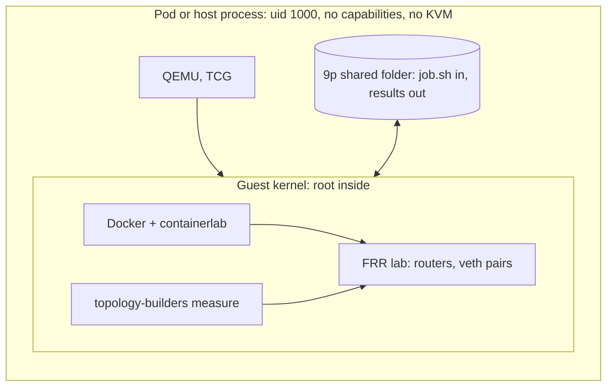

# The overlay: FRR labs without privileges

containerlab needs root, and so does anything that creates network namespaces, veth pairs or routes. On a cluster
whose pods get no added capabilities, the labs therefore run inside a guest kernel instead: QEMU, in software
emulation (TCG), as an ordinary user, with no capabilities and no `/dev/kvm`. All the privilege the labs need lives in
the guest. Inside it are Docker and containerlab, an FRR image and topology-builders, so the same `clab`, `measure`
and `report` commands run unchanged, on the same FRR image as the host labs.



| File | What it does |
|---|---|
| `build.sh` | Bakes the guest once, with KVM: Ubuntu 24.04, Docker and containerlab copied from the host, an FRR image, topology-builders. Writes `golden-flat.qcow2`. |
| `guest/` | Installed in the guest by the bake. At boot, `tb-job.sh` mounts the 9p share, runs `job.sh` with a timeout, writes `out/`, and powers off. |
| `run_tcg.sh` | Runs one job in the guest under TCG, unprivileged, on a host. |
| `jobs/validate16.sh` | The 16-router validation: random regular, degree 4; CPU per handler for one link; timing for link, router and multi-link failures. |
| `pod/` | The pod image (`build_image.sh`, `Dockerfile`, `entry.sh`) and a submitter for nats-bursting (`submit_nats.py`). The pod prints its results to its log, gzipped and base64-encoded between markers. |

Example, on a host with KVM for the bake:

```
pip download pip networkx==3.7 -d wheels && pip wheel --no-deps . -w wheels
KVM_SUDO=1 CPUSET=44-47 tools/overlay/build.sh work frr-distoptflood:e263c441 wheels
CPUSET=44-47 tools/overlay/run_tcg.sh work validate16 tools/overlay/jobs/validate16.sh 4 4096
tools/overlay/pod/build_image.sh work tools/overlay/jobs/validate16.sh ghcr.io/<owner>/tb-overlay:v16 push
```

Software emulation is slow. On 2026-11-20, with 4 vCPUs on an HP Z840, deploying the 16-router lab took 225 s,
against 9 s on the host, and the routers needed 60 s more than on the host to converge. LSP counts and the
consistency checks carry over from the host labs; CPU times and convergence times inside the guest do not, and
should be compared only with other runs in the same setup. QEMU's user-mode networking and the 9p share create
nothing on the host's network.

Status, 2026-11-20: the bake and the 16-router validation under TCG run on the host; the first pod run on a cluster
is next.
